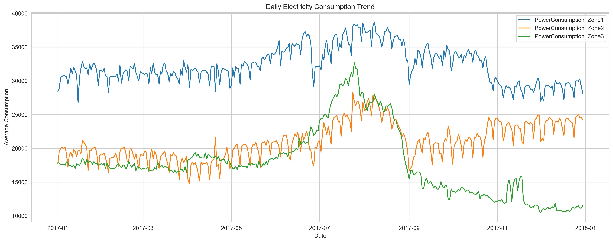

# Electricity-Consumption-and-Environmental-Factors-Analysis-Python
Exploratory data analysis of Morocco's electricity consumption patterns across three zones using Python, statistical analysis, and data visualization techniques.

## Morocco electricity consumption and environmental factors analysis | Python | Jupyter Notebook | Pandas | NumPy | Matplotlib | Plotly | Seaborn

  

## Project Files

- [Electricity_Consumption_Analytical_Report](/Electricity_Consumption_Analytical_Report.pdf)
- [Electricity_Consumption_Analysis_Methodology](Electricity_Consumption_Analysis_Methodology.pdf)
- [electricity_consumption_notebook](/electricity_consumption_notebook.ipynb)
  

## Project Overview

This project analyzes electricity consumption patterns across three geographical zones in Morocco using electricity usage and environmental data collected throughout 2017. The analysis investigates consumption trends over time, compares electricity demand across zones, identifies periods of peak and minimum consumption, and evaluates relationships between electricity consumption and environmental variables.
The project was completed as part of the AnalystLab Africa Experience Lab Internship Programme (Week 5 Data Analytics Track).

## Business Questions

The project sought to answer the following business questions:

1. What patterns can be identified in electricity consumption across the three zones?
2. During which hours and days does electricity consumption tend to be highest and lowest?
3. How does electricity consumption vary across months of the year?
4. Are temperature, humidity and wind speed associated with electricity consumption?
5. Which of the three zones records the highest and lowest consumption?
6. How can historical consumption patterns support better energy planning and management?

## Methodology
[Electricity_Consumption_Analysis_Methodology](/Electricity_Consumption_Analysis_Methodology.pdf)

## Objectives

The project aimed to:

- Analyze electricity consumption patterns across three zones.
- Identify hourly, daily, weekly, and monthly consumption trends.
- Compare electricity demand levels between zones.
- Investigate relationships between temperature, humidity, wind speed, and electricity consumption.
- Generate actionable business insights and recommendations for energy management.

## Dataset Information

The dataset contains 52,416 observations collected at 10-minute intervals between January 2017 and December 2017.

### Key Variables

- Datetime
- Temperature
- Humidity
- WindSpeed
- GeneralDiffuseFlows
- DiffuseFlows
- PowerConsumption\_Zone1
- PowerConsumption\_Zone2
- PowerConsumption\_Zone3

## Tools

- Python in VS Code
- Jupyter Notebook
- Pandas
- NumPy
- Matplotlib
- Seaborn
- Plotly

## Project Workflow

### 1. Data Quality Assessment

- Dataset inspection
- Data type validation
- Missing value assessment
- Duplicate record checks
- Timestamp validation

### 2. Data Preparation

- Datetime conversion
- Feature engineering
- Creation of time-based variables: 
    - Year
    - Month
    - Day
    - Hour
    - Day of Week
    - Date

### 3. Exploratory Data Analysis

- Average consumption by zone
- Peak and low consumption periods
- Hourly consumption analysis
- Weekly consumption analysis
- Monthly consumption analysis
- Zone comparison analysis

### 4. Environmental Analysis

- Correlation analysis
- Temperature vs consumption
- Humidity vs consumption
- Wind speed vs consumption
- Correlation heatmaps
- Regression analysis

## Key Findings

- Zone 1 recorded the highest overall electricity consumption.
- Electricity demand peaked at approximately 8:00 PM across all zones.
- July and August represented the highest demand periods during the year.
- Temperature exhibited the strongest relationship with electricity consumption.
- Humidity and wind speed demonstrated relatively weak relationships with electricity demand.
- Consumption behaviour differed significantly across the three zones.

## Business Recommendations

- Optimize electricity planning around evening peak demand periods.
- Investigate drivers of high electricity consumption in Zone 1.
- Incorporate seasonal demand patterns into operational planning.
- Consider temperature as a potential demand forecasting variable.
- Develop predictive models to improve future demand forecasting.

## Skills Demonstrated

• Python Data Analysis
• Exploratory Data Analysis (EDA)
• Data Cleaning and Validation
• Feature Engineering
• Statistical Analysis
• Time-Series Analysis
• Correlation Analysis
• Data Visualization (Matplotlib, Seaborn, Plotly)
• Interactive Visualization
• Business Insight Generation
• Analytical Reporting
• Data Storytelling
• Energy Consumption Analysis

## Author

Tessy Odiley

## Internship Program

AnalystLab Africa Data Analytics Internship
